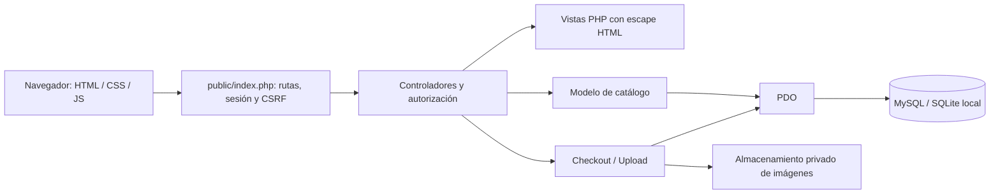
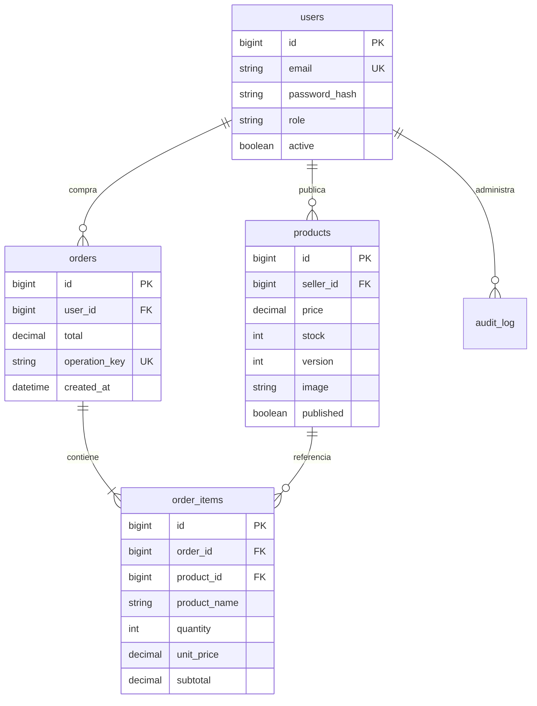

# Arquitectura y trazabilidad

## Alcance implementado

La plataforma conecta un catálogo público de productos regionales con compradores registrados, vendedores y administradores. El visitante es una condición de acceso sin sesión, no una cuenta persistida. Se almacenan tres roles: `cliente`, `vendedor` y `administrador`.

La arquitectura separa presentación (vistas y recursos públicos), aplicación (controladores y servicios) y persistencia (PDO y SQL). Las rutas convergen en `public/index.php`. No depende de un framework ni de una CDN; el diseño utiliza recursos locales y puede funcionar sin Internet después de instalar PHP y la base de datos.



## Modelo de datos



Los esquemas SQL constituyen la definición exacta de campos, claves e índices. Los importes se almacenan como DECIMAL en MySQL y se calculan en centavos enteros en PHP. Los pedidos guardan el nombre y precio de la pieza al comprar; editar el catálogo no altera esos valores históricos. La imagen y el contacto del taller se consultan desde el catálogo actual. Las bajas de usuarios preservan referencias mediante `active=0`; no eliminan físicamente pedidos.

`login_attempts` cuenta intentos fallidos por IP y por combinación de correo/IP. `audit_log` registra creación, modificación y baja de usuarios, con administrador, cuenta afectada y fecha. No almacena contraseñas en los registros.

## Confirmación de una compra

```mermaid
sequenceDiagram
    participant C as Comprador
    participant W as CarritoController
    participant S as Checkout
    participant D as Base de datos
    C->>W: POST + CSRF + clave de operación
    W->>W: Verifica rol y huella del carrito
    W->>S: Usuario, cantidades y precios revisados
    S->>D: BEGIN
    S->>D: Bloquea comprador y productos (MySQL FOR UPDATE)
    S->>S: Valida cuenta, publicación, vendedor, stock y precio
    S->>D: Inserta pedido y líneas; descuenta existencias
    alt Escrituras correctas
        S->>D: COMMIT
        S-->>W: ID del pedido
        W-->>C: Detalle y contacto de talleres
    else Error
        S->>D: ROLLBACK
        W-->>C: Mensaje para revisar el carrito
    end
```

La clave de operación única devuelve el pedido ya creado si se repite una confirmación. Los precios se vuelven a mostrar al abrir el carrito. Si cambian después de esa revisión, se rechaza la confirmación para exigir una nueva revisión. El carrito no reserva unidades. Los productos se bloquean en orden numérico para reducir conflictos; los errores de base de datos revierten toda la operación. SQLite es una alternativa local de demostración; la prueba de compras simultáneas se ejecutó sobre MariaDB/InnoDB.

La versión del producto aumenta al vender o editar. El formulario de vendedor exige la versión que abrió: si otro proceso modificó el inventario, se rechaza la edición desactualizada. Así una pantalla antigua no repone accidentalmente unidades vendidas.

## Permisos

| Acción | Visitante | Comprador | Vendedor | Administrador |
|---|---|---|---|---|
| Ver catálogo y fichas | Sí | Sí | Sí | Sí |
| Registro público de comprador | Sí | — | — | — |
| Carrito y compra | No | Sí | No | No |
| Consultar pedidos propios | No | Sí | No | No |
| Publicar y editar piezas propias | No | No | Sí | No |
| Consultar ventas del propio taller | No | No | Sí | No |
| Gestionar cuentas y roles | No | No | No | Sí |

La autorización se ejecuta en cada controlador. Modificar URLs o enviar formularios manualmente no concede permisos. Una cuenta inactiva pierde el acceso en su siguiente solicitud. Las piezas de una cuenta de vendedor inactiva o reasignada a otro rol dejan de admitir compras y de aparecer en el catálogo; el historial previo se conserva.

## Controles de seguridad

- PDO con consultas preparadas, ordenación por lista permitida y escape de comodines en búsquedas.
- `password_hash` / `password_verify`, regeneración de sesión al entrar y salir, cookie HttpOnly y SameSite=Lax. En producción se requiere HTTPS y se marca Secure.
- Sesión expirada tras 30 minutos sin actividad. Cada solicitud vuelve a consultar el estado de la cuenta.
- Token CSRF en todas las operaciones POST. Ningún GET cambia datos comerciales.
- Escape HTML en contenido de personas y productos; CSP restringida a recursos locales.
- Imágenes JPG/PNG/WebP: verificación real de MIME, dimensiones y tamaño; recodificación WebP, nombre aleatorio y almacenamiento privado. No se permiten SVG subidos por vendedores. Los SVG originales incluidos son recursos estáticos controlados por el proyecto.
- Protección del último administrador activo y de la propia cuenta administrativa al cambiar permisos o dar de baja.
- Validación del lado del servidor; la validación HTML mejora la experiencia, sin reemplazarla.

## Matriz de requisitos

| Requisito | Implementación | Evidencia de prueba |
|---|---|---|
| Nombre, material y utilidad | Product, product.php, formulario vendedor | Ficha completa y alta por HTTP |
| Imagen del producto | Upload, /media, recursos locales | Imagen PNG aceptada; SVG rechazado |
| Breviario histórico o anecdótico | history y source, ficha pública | Validación de formulario y consulta pública |
| Cantidad en almacén y precio | stock, price, versión | Edición, compra y transacciones |
| Catálogo para todos | CatalogController y Product | GET anónimo 200; búsqueda y filtros |
| Solo registrados compran | require_role('cliente') | Visitante redirigido; otros roles 403 |
| Registro e inicio de sesión | AuthController | Registro, acceso y cuenta inactiva |
| Vendedor adiciona productos | SellerController | Alta real con imagen y dueño verificado |
| Admin añade/modifica/elimina usuarios | AdminController, baja lógica | Crear, editar, desactivar y revocar sesión |
| Inventario consistente | Checkout, FOR UPDATE, clave única | Dos compradores y una unidad; rollback |
| Privacidad de pedidos | Consulta por id + user_id | Pedido ajeno devuelve 404 |
| Diseño adaptable | app.css, navegación accesible | Prueba de navegador incluida para ejecución local |

## Decisiones y extensiones

Se entrega un MVP de compra mediante pedido. La pasarela bancaria, cálculo de envíos, correos automáticos, recuperación de contraseña por correo, cancelaciones y reembolsos requieren integraciones posteriores. El administrador puede establecer una nueva contraseña desde su panel; no hay un flujo automático de recuperación.

Antes de operar comercialmente se deben establecer los datos legales del responsable, el aviso de privacidad, políticas comerciales y contactos reales. El código no inventa contratos, ventas, comprobantes de despliegue ni certificaciones de los productos. Los esquemas incluyen `IF NOT EXISTS` para una primera instalación repetible; futuras modificaciones deben acompañarse de migraciones versionadas.

## Referencias técnicas

PHP Group. (s. f.). *PDO: Transactions and auto-commit*. https://www.php.net/manual/en/pdo.transactions.php

PHP Group. (s. f.). *Handling file uploads*. https://www.php.net/manual/en/features.file-upload.php

Oracle. (s. f.). *MySQL 8.4 Reference Manual: Locking reads*. https://dev.mysql.com/doc/refman/8.4/en/innodb-locking-reads.html
